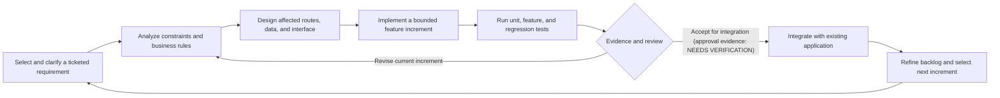
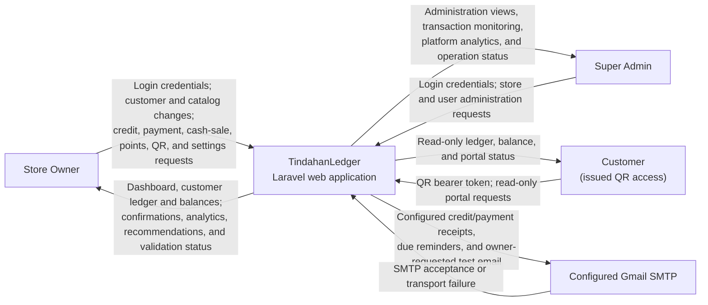
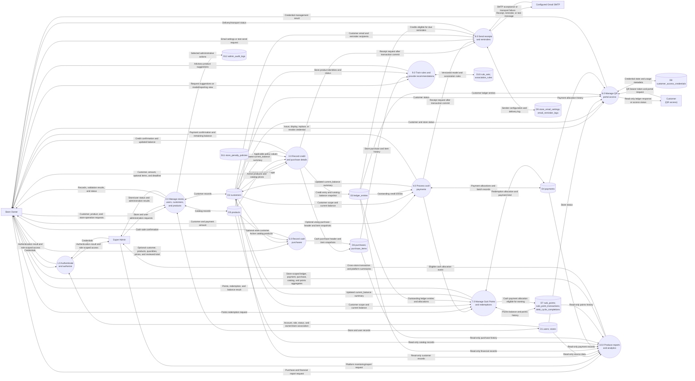
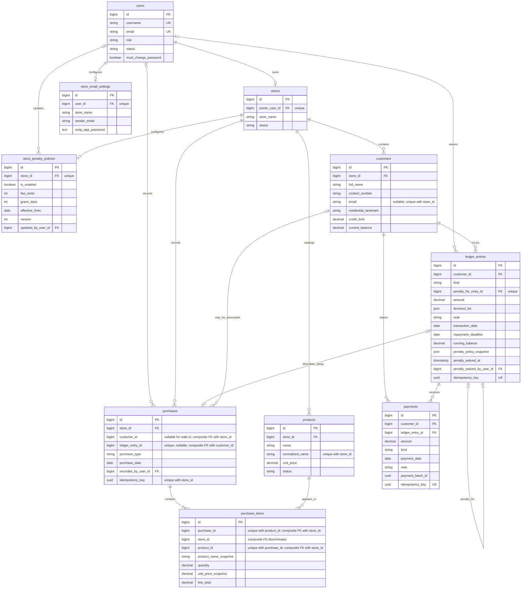
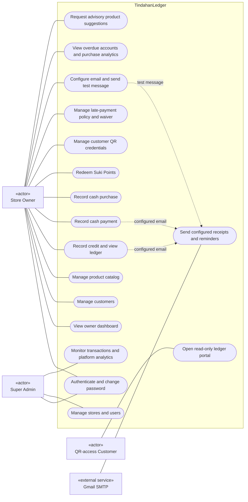

# CHAPTER 4
# METHODOLOGY, RESULTS AND DISCUSSION

## 4.2 Design of Software, Systems, Product, and/or Processes

This section describes the development process and design of TindahanLedger using the checked-in Laravel application, migration history, tests, README, audit handoff, and Git ticket/branch evidence. The repository contains a working implementation for store-owner and Super Admin workflows, financial records, products and purchases, customer QR access, Suki Points, email infrastructure, late penalties, and product recommendations. Those implementation facts do not establish that the system was deployed to a production environment, accepted by end users, or evaluated on live store data.

### 4.2.1 Systems Development Life Cycle (SDLC) Processes

#### Selected model and rationale

The development evidence most closely supports an **iterative and incremental SDLC model**. In this model, a system is developed through a sequence of usable increments. Each increment involves selecting and clarifying a bounded set of requirements, designing the affected elements, implementing changes, testing the result, and using the accumulated feedback or discovered constraints to shape subsequent work. Iterative and incremental development is a recognized software-development approach with a documented history (Larman & Basili, 2003).

TindahanLedger's repository shows work organized around ticket identifiers and feature-sized commits. The branch list contains ticket-named branches, including branches for DUMS-35 through DUMS-41 and earlier DUMS tasks. The commit history shows incremental additions such as structured credit purchase items (DUMS-36), cash purchase recording (DUMS-37), external dataset validation (DUMS-38), association-rule training (DUMS-39), product suggestions (DUMS-40), and purchase analytics/evaluation (DUMS-41). Later commits further refined the recommendation snapshot and activation behavior. The test suite contains separate feature and unit tests aligned with these capabilities. Together, this evidence is consistent with ticket-oriented, iterative delivery and subsequent refinement.

The evidence does **not** establish that the project formally adopted Scrum, used fixed-length sprints, held prescribed Scrum ceremonies, or followed a specific Agile framework. The README and Sprint 1 handoff refer to Jira ticket identifiers, and Git branches support feature-branch work; however, a Jira board export, sprint records, pull-request review history, and team meeting records were not available for inspection. Accordingly, the model is described as iterative and incremental, with ticket-based and Agile-influenced practices, rather than as formal Scrum. The Agile Manifesto is relevant as a conceptual comparison because it values working software, collaboration, and responsiveness to change; the available repository evidence does not establish conformance to the Manifesto or its specific methods (Beck et al., 2001).

**Figure 4.1. Iterative and incremental development cycle applied to TindahanLedger**



The model represents a retrospective synthesis of observable development artifacts; it is not a claim that every ticket passed through a documented approval gate. In particular, evidence of formal requirement acceptance or release approval was not located.

**Table 4.4. SDLC phases and TindahanLedger evidence**

| Phase | Purpose in the selected model | Actual TindahanLedger activities evidenced | Supporting project evidence | Evidence limitation |
|---|---|---|---|---|
| Requirements selection and analysis | Select a bounded problem, record expected behavior, and identify business constraints for an increment. | Ticket-keyed work is visible in commit subjects and branch names. Feature scope is reflected in implementation and documentation for customer/ledger workflows, purchases, QR access, email, loyalty, and recommendations. | Ticket identifiers in `README.md` and `SPRINT-1-AUDIT-HANDOFF.md`; Git commit subjects such as DUMS-36 through DUMS-41; feature-specific Form Requests and tests. | The Jira board, issue descriptions/status history, approved acceptance criteria, and stakeholder sign-off are **[NEEDS VERIFICATION]**. |
| Analysis and design | Translate requirements into routes, role boundaries, validation, services, data relationships, and user flows. | Laravel routes and middleware separate Store Owner, Super Admin, and customer portal access. Migration files progressively introduce stores, financial records, products/purchases, points, credentials, reminders, penalties, and recommendation rule sets. | `routes/web.php`; `bootstrap/app.php`; `app/Http/Requests/`; `app/Policies/`; `app/Services/`; `database/migrations/`; relevant models and tests. | No dated, approved design specification or review minutes were found. Some design decisions are documented in source comments/README, not in a separate signed design record. |
| Incremental implementation | Add a working capability without treating the whole system as a single one-time release. | Ticket-oriented feature work includes itemized credit purchase support, cash purchases, basket validation, a single-item association-rule engine, transaction-entry suggestions, and purchase analytics. The branch list contains feature-/ticket-named branches; their names support branch-based work but do not alone prove review or merge procedures. | Git branch names and history; Laravel controllers/services; migrations; Blade views; `composer.json` and `package.json`. | Exact branch-to-merge mapping, pull-request approval, release tags, and deployment history are **[NEEDS VERIFICATION]**. |
| Verification and regression testing | Check the increment's expected behavior and guard existing financial workflows against regressions. | Separate Pest feature and unit tests cover authentication, role access, tenant isolation, credit/payment behavior, cash purchases, QR portal behavior, mail settings, Suki Point redemption, and recommendation logic. | `tests/Feature/`; `tests/Unit/`; `phpunit.xml`; project README and Sprint 1 audit handoff. | Tests run here use SQLite `:memory:` as configured in `phpunit.xml`. Production MySQL/MariaDB concurrency and browser/device behavior are not established by that suite. |
| Review and refinement | Use test findings, observed constraints, and additional requirements to revise or extend the system. | Later ticketed commits refine recommendation snapshots/activation and add analytics/evaluation. Documentation explicitly limits customer-specific recommendations and external dataset import; README warns that the available external basket file is unsuitable and not approved for customer-facing use. | Later DUMS-39 and DUMS-41 commits; `README.md` sections on DUMS-38 through DUMS-41; recommendation and analytics services/tests. | Formal retrospective records, backlog prioritization history, user feedback, and approval of the next increment are **[NEEDS VERIFICATION]**. |
| Release and operation | Package, deploy, monitor, and maintain an accepted increment. | README documents how to configure a production scheduler and how to perform restricted local QR testing. Scheduler commands are defined in source. | `README.md`; `routes/console.php`; `app/Console/Commands/`; application configuration. | A production host, actual release, public deployment, operational ownership, backup procedure, and production monitoring are not evidenced. Local instructions are not proof of deployment. |

**Discussion.** Iterative and incremental development is a better fit for the available project evidence than a strictly sequential model because the codebase contains separately identifiable feature increments, ticket-named branches and commits, associated automated tests, and later changes that refine earlier capabilities. Larman and Basili (2003) describe iterative and incremental development as an approach with a long history in software development; it provides an appropriate conceptual basis for discussing increments and successive refinement. The Agile Manifesto (Beck et al., 2001) offers related values, but the available records are insufficient to call the project Scrum or to claim that all Agile principles or ceremonies were followed.

For TindahanLedger, the phases are best interpreted as recurring work practices rather than a single completed linear sequence. A credit/payment requirement, for example, is represented in request validation, transaction services, schema constraints, and focused tests. Later capabilities such as cash sales and recommendation analytics add new increments while relying on existing customer, store, product, and purchase structures. The model also accommodates refinement when implementation evidence reveals a limitation. Such a limitation is visible in the README's warning that external data are not suitable for live recommendations and in the later recommendation snapshot/activation refinements. However, source history cannot establish who reviewed each change, whether a store owner approved it, or whether the change was deployed.

The test suite was executed during the documentation task and reported **858 tests passed with 3,348 assertions**. This is a completed automated test result, not a result predicted by the model. `phpunit.xml` configures SQLite `:memory:` for tests; therefore, the result must not be interpreted as a production acceptance test, a MySQL/MariaDB concurrency result, or evidence of user acceptance. Further detailed test activities and their status are given in Table 4.5.

### 4.2.2 Test Plan

Table 4.5 identifies planned assessment procedures and the criteria that should be used when they are performed. “Expected outcome” is a pass criterion for future execution and is not, by itself, a claim that a test passed. A completed result is identified explicitly where repository or current execution evidence exists.

**Table 4.5. TindahanLedger test plan**

| Test Phase or Module | Testing Method | Actual Plan and Test Procedure | Assessment Criteria and Expected Outcome |
|---|---|---|---|
| Authentication and authorization | Automated feature tests for valid/invalid login, throttling, active/inactive accounts, temporary-password change, role restrictions, logout, and protected routes; manual browser check on the approved release. | **Implemented tests exist** in `OwnerAuthenticationTest.php`, `ChangePasswordTest.php`, and `RoleAccessTest.php`. Run the focused tests after authentication changes. Verify that successful login rotates the session; logout invalidates it and regenerates the CSRF token. Browser/device validation is **planned / [NEEDS VERIFICATION]**. | Valid users are authenticated and directed according to role; inactive or invalid accounts cannot access protected functions; throttling is enforced; temporary passwords are changed before normal access; logout ends the session. No protected route is accessible to a guest or wrong role. |
| Customer and store isolation | Automated cross-store access tests against customer, ledger, transaction summaries, and store-scoped records; review route policies and database constraints. | **Implemented tests exist** in `TenantIsolationTest.php`, `CustomerPolicyTest.php`, and `ProductPolicyTest.php`. Run them after modifying store-scoped queries, policies, or route middleware. Supplement with a target-database check of composite foreign keys. | An owner can access only records belonging to the owner's store; attempts to access another store's customer/financial record do not disclose the record; cross-store relations cannot be persisted where composite constraints apply. Target MySQL/MariaDB constraint test is **planned / [NEEDS VERIFICATION]**. |
| Credit transaction recording | Feature tests for valid credit, invalid/zero amount, limit boundary, limit overrun, invalid products, duplicate submission key, transaction rollback, and structured purchase items. | **Implemented tests exist** in `RecordCreditTest.php`, `StructuredCreditItemsTest.php`, and related workflow tests. Run focused tests for service/request/migration changes; verify a credit and its structured purchase items are committed together. | Valid credit within the limit persists once and updates the customer balance; over-limit and invalid submissions are rejected with no partial records; the same idempotency key does not create a duplicate. Concurrency on the intended production database remains **[NEEDS VERIFICATION]**. |
| Payment recording and balance accuracy | Feature tests for partial/full payment, overpayment, FIFO allocation, repeated idempotency key, batch grouping, and customer balance/running history; hand-calculate representative balances and compare with service output. | **Implemented tests exist** in `RecordPaymentTest.php`, `CustomerLedgerTest.php`, `LedgerWorkflowTest.php`, and `TransactionReceiptTest.php`. The handoff identifies a remaining historical-confirmation limitation: when the original session receipt is absent, an old confirmation may derive previous/remaining balances from current customer activity. Add/execute a regression test after later transactions are recorded. | Payment cannot exceed the applicable outstanding amount; allocation order and running balances match business rules; repeat submission does not apply twice. Historical confirmation must not present current balance as a batch-time balance. The latter behavior is **not established as safely implemented** and requires corrective verification. |
| Product catalog | Feature tests for create/update, normalization, active/inactive status, store scoping, price validation, and catalog access. | **Implemented tests exist** in `ProductCatalogTest.php` and `ProductPolicyTest.php`. Run focused tests when catalog validation, status, or pricing logic changes. | Only valid products in the owner's store can be added/updated; inactive or foreign-store products cannot be used in a transaction; invalid prices/names are rejected. |
| Cash purchase recording | Feature tests for item/quantity validation, server-side line total, expected-total mismatch, walk-in/known customer, duplicate products, inactive/out-of-store products, idempotency, and separation from debt/points. | **Implemented tests exist** in `CashPurchaseTest.php`. Run after changes to price calculation, item schemas, or purchase persistence. | A valid purchase persists consistent item snapshots and calculated total exactly once; a stale or invalid expected total is rejected; cash purchase creates no credit/payment and does not change debt balance or Suki Points. |
| Customer self-service QR portal | Feature tests for credential issue/reissue/revoke, malformed/unknown/revoked token, store suspension, session rotation/idle timeout, read-only access, privacy headers, and rate limit; manual scan on approved mobile browsers. | **Implemented tests exist** in `CustomerAccessCodeTest.php` and `CustomerPortalTest.php`. README provides local-network/hotspot scan instructions, but an actual device test is not evidenced. Conduct manual scanning only on a trusted network and record device/browser and result. | Only an active credential opens the corresponding customer's read-only portal; revoked credentials stop working; session is regenerated and ends at configured inactivity; suspended store is unavailable; private responses are not cached and do not send referrer data. Real-device verification is **planned / [NEEDS VERIFICATION]**. |
| Email notifications and reminders | Unit/feature tests with mocked SMTP transport; verify scheduled command configuration and retry/log behavior; controlled Gmail delivery to an authorized mailbox. | **Automated transport/settings tests exist** in `ReusableEmailTest.php`, `EmailSettingsTest.php`, and `PaymentReminderServiceTest.php`. README and the audit handoff state that no real Gmail credentials/message/inbox delivery were verified. A real send is a separate manual test requiring owner-provided credentials stored only in local secret configuration. | Invalid recipients are rejected; secrets are not exposed in serialization/logs; failures are recorded/reported; reminders follow schedule and duplicate-prevention rules. SMTP mock acceptance is not inbox delivery. Actual Gmail delivery remains **[NEEDS VERIFICATION]**. |
| Suki Points earning, cycle completion, and redemption | Feature tests for accrual/remainders, cycle thresholds, rewards, redemption limits, no-debt case, repeated key, and atomic points/payment updates. | **Implemented tests exist** in `SukiPointEarningTest.php`, `SukiCycleRewardTest.php`, and `SukiPointRedemptionTest.php`. Run focused tests after any change to payment, cycle, or loyalty rules. | Points match configured earning and reward rules; redemption cannot exceed points or eligible outstanding debt; points deduction and ledger allocation are atomic; replay of the same key does not deduct twice. |
| Recommendation engine and transaction-entry suggestions | Unit/feature tests for basket counts, support/confidence/lift, thresholds, store isolation, model lifecycle, ranking, no active model, and read-only endpoint; offline held-out evaluation on eligible data. | **Implemented tests exist** in `AssociationRuleTrainingTest.php`, `ProductRecommendationServiceTest.php`, `ProductRecommendationEndpointTest.php`, `RecommendationEvaluationTest.php`, and related unit tests. README documents a local MariaDB performance benchmark and synthetic offline evaluation; it explicitly says external baskets are not approved for customer-facing recommendations and the 301-basket evaluation is exploratory. | Rules and suggestions use the correct store's active rule set, only active products, and the documented metrics/ranking. No customer data is exposed and the suggestion endpoint does not change a transaction. Effectiveness on representative sari-sari data is **[NEEDS VERIFICATION]**. |
| Regression suite and target-database verification | Run focused Pest tests for changed modules, then full test suite; separately run approved MySQL/MariaDB integrity/concurrency tests. | **Completed during documentation work:** full `php artisan test --compact` reported 858 passed and 3,348 assertions. `phpunit.xml` uses SQLite `:memory:`. **Not completed by that run:** MySQL/MariaDB concurrency/integration verification, production browser/device tests, or deployment acceptance. | The recorded suite result is reproducible only with its recorded environment. Target-database and release tests must be reported separately with database/version, dataset, duration, and outcomes. |

**Discussion.** The testing strategy combines focused feature tests at HTTP/service boundaries with unit tests for calculations and supporting services. The repository's test organization is suitable for testing business rules such as credit limits, overpayment rejection, idempotent submissions, customer/store isolation, and Suki Point redemption without substituting a user-interface value for server validation. ISO/IEC 25010:2023 can guide the definition of quality characteristics and measurable acceptance criteria, while OWASP ASVS 5.0.0 provides a structured source for security verification activities (ISO, 2023; OWASP Foundation, n.d.).

The current full-suite result is explicitly limited to the configured SQLite in-memory test environment. It does not show production database locking semantics, deployment configuration, network behavior, visual responsiveness, customer understanding of QR access, or Gmail delivery. The README's local recommendation timings and synthetic evaluation results should be treated as development evidence only, with dataset and setup limitations retained. Future execution records should identify the tested commit, test command, runtime/database version, test data, failures, and corrective retest where applicable.

### 4.2.3 Security Plan

The plan below combines actual application controls with assessment activities that remain to be executed or verified. “Implemented” refers only to the inspected code and migrations; it is not a statement of certification or complete security assurance.

**Table 4.6. TindahanLedger security plan**

| Security Layer | Actual Security Plan and Implementation | What to Assess During Security Testing |
|---|---|---|
| Owner/admin authentication | **Implemented:** authenticated web routes; active-account middleware; distinct Store Owner and Super Admin role checks; login rate limiting; session ID regeneration on login; logout invalidation and CSRF-token regeneration; forced change of administrator-issued temporary password. `User` uses Laravel's `hashed` password cast. | Attempt guest, inactive-account, wrong-password, throttled, wrong-role, and temporary-password access. Verify session rotation and termination. Inspect the deployed password-hashing configuration, password policy, TLS, and cookie settings; production configuration is **[NEEDS VERIFICATION]**. |
| Authorization and store isolation | **Implemented:** owner routes are scoped by the signed-in user's store; role middleware and policies protect operations; customer/ledger access checks ownership; migrations contain store/customer consistency constraints; tenant-isolation tests exist. | Test direct object references, altered IDs, query parameters, and all read/write routes across two stores. Verify DB composite constraints on the target engine and ensure new endpoints do not trust a submitted store ID. |
| Financial transaction integrity | **Implemented:** server-side Form Request validation; services enforce business rules; database transactions and row locks are used for credit/payment/redemption workflows; UUID idempotency keys protect selected replayable submissions; foreign keys restrict deletion of financial history. | Test invalid/negative/over-limit amounts, duplicate/replayed submissions, partial failure/rollback, concurrent operations, payment/customer/entry consistency, and auditability. MySQL/MariaDB concurrency tests and production record integrity remain **[NEEDS VERIFICATION]**. |
| Customer QR portal | **Implemented:** random bearer tokens; hash-based lookup; encrypted printable token; revocation/reissue; per-request active credential/store checks; rate-limited token submission; session regeneration and idle expiry; read-only customer ledger; private/no-store/no-referrer response headers. QR possession authenticates possession of the code, not the holder's identity. | Test malformed, guessed, copied, revoked, replaced, expired-session, and suspended-store cases; ensure the token is absent from initial request path/referrer/logs and portal has no state-changing routes. Review issuance, reprinting, physical display, and revocation procedures. |
| Input validation, query/data handling, and browser request protections | **Implemented in reviewed routes:** Laravel Form Requests/request validation and Eloquent/query-builder access are used on inspected flows; web routes use Laravel's web middleware group; Blade templates are used. This review is not an exhaustive injection/output-encoding assessment. | Run a full endpoint inventory and test boundary inputs, authorization-before-disclosure, CSRF enforcement in a non-test runtime, output encoding, and any raw SQL. Confirm parameter binding on every untrusted query and verify error responses do not disclose customer data. |
| Customer financial-information privacy | **Implemented:** owner access is store scoped; customer portal returns a read-only ledger; private portal pages set cache/referrer protections; customer and purchase histories are modeled with relational constraints. **Not established:** production HTTPS, database/back-up encryption, privacy notice, retention schedule, lawful basis, or privacy-impact/legal review. | Check deployed TLS and headers, cache behavior, cookie configuration, log redaction, least-privilege DB/storage access, data retention and deletion process, and disclosure boundaries. Determine applicable obligations under Republic Act No. 10173 and National Privacy Commission guidance; do not claim compliance without organizational/legal review. |
| Email credentials and notification handling | **Implemented:** SMTP App Password is encrypted at rest using Laravel's encrypted cast and hidden from model serialization; Gmail transport uses port 587 and requires TLS; mail failure logging masks recipient/sensitive values; email test route is authenticated and rate limited. Email delivery is synchronous in the inspected receipt workflow. Real Gmail delivery was not verified. | Inspect secret exposure in source, environment/config/cache, logs, model/API serialization, and exception output. Verify TLS negotiation and authorized recipient behavior in a controlled environment; do not include secret credentials in test evidence. Confirm failure/retry behavior and that SMTP failure does not falsely report successful delivery. |
| Administrative audit and operational security | **Implemented in part:** an `AdminAuditLogger` and audit-log model/migration exist for selected administrative actions. **[NEEDS VERIFICATION]:** completeness of sensitive-action coverage, retention, access to logs, deployment monitoring, backup encryption, incident response, and patch cadence. | Attempt unauthorized administrative actions; verify actor/action/subject evidence without passwords or SMTP secrets; assess log access, integrity, retention, alerting, dependency updates, and incident escalation. Compare controls with OWASP ASVS 5.0.0 and NIST SP 800-53 Rev. 5, Update 1 without asserting conformance (NIST, 2020; OWASP Foundation, n.d.). |

**Discussion.** Security is addressed through multiple application layers rather than a single login check. The route configuration distinguishes owner and Super Admin functions, while customer policies and store-derived queries constrain records by tenant. Financial services add validation and transactional checks. QR portal access is intentionally a bearer-token mechanism: anyone possessing a valid QR code can access that customer's read-only ledger until the credential is revoked or the session expires. This limitation must remain explicit in user-facing procedures and any privacy assessment.

The source demonstrates specific safeguards, but several important controls are operational or deployment-dependent. In particular, repository inspection cannot establish whether the deployed system enforces HTTPS, uses hardened cookie flags, protects application keys and database backups, or has an incident-response process. Testing must therefore assess the actual deployment as well as code. OWASP ASVS 5.0.0 and NIST SP 800-53 Rev. 5, Update 1 can be used to organize technical and organizational control checks, but no formal assessment or compliance claim is made (NIST, 2020; OWASP Foundation, n.d.).

### 4.2.4 Context Diagram

Figure 4.2 treats TindahanLedger as one system boundary and shows only verified external actors and services. The relational database, application scheduler, Laravel framework, and browser are internal implementation components or runtime mechanisms, not external entities in this context diagram. The source confirms three human roles—Store Owner, Super Admin, and Customer using an issued QR bearer credential—and the configured Gmail SMTP transport. No other external service integration was found.

**Figure 4.2. Context diagram of the TindahanLedger system**



The diagram distinguishes the customer-facing portal from the authenticated owner and administrator workflows. A customer submits a bearer token from an issued QR code and receives only the corresponding read-only ledger view; the code proves possession of the credential, not the identity of the person holding it. Gmail SMTP is the only external service represented because the application contains a configured Gmail transport. Actual Gmail inbox delivery has not been verified, so the return flow denotes transport acceptance or failure rather than confirmed receipt.

### 4.2.5 Data Flow Diagram

Figure 4.3 decomposes the system boundary into Level 1 processes and logical data stores. Data-store labels name the actual application tables or groups of related tables defined by migrations. Process flows summarize the route/controller/service behavior; they do not imply that the application uses separate deployed services. The external entities match Figure 4.2.

**Figure 4.3. Level 1 data flow diagram for TindahanLedger**



The processes preserve the application's business distinctions. A credit creates a ledger entry and may create a linked `utang` purchase with item snapshots; a cash purchase creates purchase records only and does not create debt or points. A cash repayment creates one or more payment allocations against outstanding ledger entries, updates the customer's balance summary, and supplies eligible cash allocations to Suki Points processing. A points redemption is recorded as a non-cash payment allocation and a points-history transaction. The recommendation endpoint reads store-scoped purchases, products, and active rules to return advisory suggestions; the application also has a rule-training command that writes versioned rule data. External basket validation is not a customer-facing data source. The data-flow diagram groups tables for legibility, while the ERD below specifies their separate entities and key constraints.

### 4.2.6 System Flowchart

Figure 4.4 follows an owner through authentication and the main operational workflows. It also shows the separate QR customer path because customer access does not begin with owner login. The diagram reflects server-side validation and transactional persistence found in the controllers and services; it is a high-level workflow, not a screen-by-screen user-interface specification.

**Figure 4.4. Main TindahanLedger application workflow**

```mermaid
flowchart TD
    Start([Start]) --> Login["Store Owner enters credentials"]
    Login --> Auth{"Valid, active account<br/>and authorized role?"}
    Auth -->|"No"| Deny["Reject login; display error"]
    Deny --> Login
    Auth -->|"Yes"| Password{"Password change required?"}
    Password -->|"Yes"| Change["Change temporary password"]
    Change --> OwnerDash["Open Store Owner dashboard"]
    Password -->|"No"| OwnerDash

    OwnerDash --> Choice{"Select owner workflow"}

    Choice -->|"Record credit"| CreditForm["Select customer; enter amount,<br/>optional items, and due-date details"]
    CreditForm --> CreditStore{"Active store and customer<br/>in the owner's store?"}
    CreditStore -->|"No"| CreditError["Reject unauthorized or inactive-store request"]
    CreditStore -->|"Yes"| CreditIdem{"Request key already processed?"}
    CreditIdem -->|"Yes"| CreditReplay["Return prior transaction result;<br/>do not create a duplicate"]
    CreditReplay --> CreditConfirm
    CreditIdem -->|"No"| CreditCheck{"Amount within credit limit;<br/>credit items valid?"}
    CreditCheck -->|"No"| CreditBusinessError["Return validation/business-rule error"]
    CreditBusinessError --> CreditForm
    CreditCheck -->|"Yes"| CreditTx["In one database transaction:<br/>save ledger entry, update balance,<br/>and save optional purchase/item rows"]
    CreditTx --> CreditCommit["Commit credit transaction"]
    CreditCommit --> CreditReceipt{"Configured recipient<br/>and mail settings?"}
    CreditReceipt -->|"Yes"| CreditMail["Attempt credit receipt through Gmail SMTP"]
    CreditReceipt -->|"No"| CreditConfirm["Show credit confirmation and balance"]
    CreditMail --> CreditConfirm
    CreditConfirm --> OwnerDash

    Choice -->|"Record payment"| PaymentForm["Select customer; enter valid cash amount"]
    PaymentForm --> PaymentStore{"Active store and customer<br/>in the owner's store?"}
    PaymentStore -->|"No"| PaymentError["Reject unauthorized or inactive-store request"]
    PaymentStore -->|"Yes"| PaymentIdem{"Request key already processed?"}
    PaymentIdem -->|"Yes"| PaymentReplay["Return prior payment result;<br/>do not allocate again"]
    PaymentReplay --> PaymentConfirm
    PaymentIdem -->|"No"| PaymentCheck{"Amount does not exceed<br/>outstanding balance?"}
    PaymentCheck -->|"No"| PaymentBusinessError["Return validation/business-rule error"]
    PaymentBusinessError --> PaymentForm
    PaymentCheck -->|"Yes"| PaymentTx["In one database transaction:<br/>allocate oldest unpaid entries first;<br/>save payment rows; update balance;<br/>award eligible cash-payment points"]
    PaymentTx --> CycleCheck{"Customer balance<br/>now zero?"}
    CycleCheck -->|"Yes"| CompleteCycle["Record debt-cycle completion<br/>and any applicable cycle reward"]
    CycleCheck -->|"No"| PaymentCommit["Commit payment transaction"]
    CompleteCycle --> PaymentCommit
    PaymentCommit --> PaymentReceipt{"Configured recipient<br/>and mail settings?"}
    PaymentReceipt -->|"Yes"| PaymentMail["Attempt payment receipt through Gmail SMTP"]
    PaymentReceipt -->|"No"| PaymentConfirm["Show payment confirmation and remaining balance"]
    PaymentMail --> PaymentConfirm
    PaymentConfirm --> OwnerDash

    Choice -->|"Record cash purchase"| CashForm["Optionally select customer;<br/>select products, quantities, and prices"]
    CashForm --> CashStore{"Store active?"}
    CashStore -->|"No"| CashError["Reject inactive-store request"]
    CashStore -->|"Yes"| CashIdem{"Request key already processed?"}
    CashIdem -->|"Yes"| CashReplay["Return prior sale result;<br/>do not create a duplicate"}
    CashReplay --> CashConfirm
    CashIdem -->|"No"| CashCheck{"Catalog items valid and<br/>server total matches reviewed total?"}
    CashCheck -->|"No"| CashBusinessError["Return validation/business-rule error"]
    CashBusinessError --> CashForm
    CashCheck -->|"Yes"| CashTx["Save cash purchase and item snapshots<br/>in a database transaction"]
    CashTx --> CashConfirm["Show cash-sale confirmation<br/>(no debt or Suki Points change)"]
    CashConfirm --> OwnerDash

    Choice -->|"Redeem Suki Points"| RedeemForm["Select customer and valid points amount"]
    RedeemForm --> RedeemStore{"Active store and customer<br/>in the owner's store?"}
    RedeemStore -->|"No"| RedeemScopeError["Reject unauthorized or inactive-store request"]
    RedeemStore -->|"Yes"| RedeemIdem{"Request key already processed?"}
    RedeemIdem -->|"Yes"| RedeemReplay["Return prior redemption result;<br/>do not deduct again"]
    RedeemReplay --> RedeemConfirm
    RedeemIdem -->|"No"| RedeemCheck{"Points available and redemption<br/>does not exceed outstanding debt?"}
    RedeemCheck -->|"No"| RedeemBusinessError["Reject redemption; preserve points and balance"]
    RedeemBusinessError --> RedeemForm
    RedeemCheck -->|"Yes"| RedeemTx["Atomically record non-cash payment allocations,<br/>deduct points, write points history,<br/>and update customer balance"]
    RedeemTx --> RedeemConfirm["Show redemption and remaining balance"]
    RedeemConfirm --> OwnerDash

    Choice -->|"Manage or review"| Other["Manage customers/products, QR credentials,<br/>email and penalty settings; view overdue accounts,<br/>analytics, dashboards, and advisory suggestions"]
    Other --> OwnerDash

    Admin["Super Admin"] --> AdminLogin["Enter administrator credentials"]
    AdminLogin --> AdminRole{"Account active and<br/>Super Admin role?"}
    AdminRole -->|"No"| AdminDeny["Reject or deny protected access"]
    AdminRole -->|"Yes"| AdminPassword{"Password change required?"}
    AdminPassword -->|"Yes"| AdminChange["Change temporary password"]
    AdminChange --> AdminDash["Super Admin dashboard"]
    AdminPassword -->|"No"| AdminDash
    AdminDash --> AdminWork["Manage stores/users; review<br/>transaction monitoring and platform analytics"]
    AdminWork --> AdminDash

    OwnerDash -->|"Manage customer QR"| IssueQR["Issue, display, replace, or revoke QR credential"]
    IssueQR --> SharedQR["Credential shared with customer"]
    Customer["Customer with issued QR"] --> ScanQR["Scan QR and submit bearer token"]
    SharedQR --> ScanQR
    ScanQR --> TokenCheck{"Credential valid and<br/>store active?"}
    TokenCheck -->|"No"| PortalDenied["Deny portal access"]
    TokenCheck -->|"Yes"| PortalRead["Start protected customer session;<br/>read customer ledger and balance"]
    PortalRead --> PortalView["Display read-only portal"]
    PortalView --> PortalExit["Customer exits or session expires"]
```

The main flow shows that the owner dashboard is reached only after account and role checks, with a forced password-change step where required. Each credit, payment, cash purchase, and redemption request resolves its idempotency key before creating new financial records, preventing a repeated submission from duplicating the transaction. Credit and payment decisions are validated on the server and written transactionally. Payment allocation is oldest-first; cash allocations can earn Suki Points, and a cleared debt cycle may create a completion record. Cash purchases are deliberately separate from debt recording. Points redemption is also a separate owner action that reduces debt as a non-cash allocation while deducting points in the same transaction. The QR flow starts from the owner's credential-management workflow and permits only read access after the bearer credential and store status are validated. Credit/payment receipt attempts occur only for newly created transactions and after commit; SMTP failure does not undo a committed ledger transaction.

### 4.2.7 Entity Relationship Diagram (ERD)

Figures 4.5(a) and 4.5(b) form a two-part ERD of the TindahanLedger domain tables represented in the migrations. The diagrams use actual table and column names and show primary keys, foreign keys, important unique constraints, and relationship cardinalities. Attribute lists are focused on identifiers and business-significant fields to keep the figure readable; timestamps, framework-managed columns, and secondary indexes are omitted. Laravel infrastructure tables such as `sessions`, `cache`, `jobs`, `job_batches`, `failed_jobs`, and `password_reset_tokens` are not shown because they are not domain entities. The diagrams describe the migration-defined schema, not a verified production database instance.

**Figure 4.5(a). Core store, customer, ledger, catalog, and purchase entities**



Figure 4.5(a) traces the store's primary commercial records. It separates account ownership, customer profiles, ledger entries, payment allocations, product catalog records, and purchase headers from purchase-item details. The optional links on `purchases` distinguish a `utang` purchase from a walk-in cash purchase. Store and customer consistency is enforced with composite foreign keys, while payments must point to a ledger entry for the same customer.

**Figure 4.5(b). Loyalty, portal, notification, audit, and recommendation entities**

```mermaid
erDiagram
    users o|--o{ suki_point_transactions : records
    users o|--o{ customer_access_credentials : created_by
    users o|--o{ customer_access_credentials : revoked_by
    users ||--o{ admin_audit_logs : performs
    customers ||--o| suki_points : has_balance
    customers ||--o{ suki_point_transactions : has_history
    payments ||--o| suki_point_transactions : may_be_tracked
    customers ||--o{ debt_cycle_completions : completes
    payments o|--o| debt_cycle_completions : may_complete
    customers ||--o{ customer_access_credentials : has_credentials
    customers o|--o| customer_access_credentials : active_customer_id
    customers ||--o{ email_reminder_logs : receives
    ledger_entries ||--o{ email_reminder_logs : triggers
    stores o|--o{ rule_sets : trains
    rule_sets ||--o{ association_rules : contains
    products o|--o{ association_rules : antecedent_product
    products o|--o{ association_rules : consequent_product

    users {
        bigint id PK
        string username UK
        string role
    }
    stores {
        bigint id PK
        string store_name
    }
    customers {
        bigint id PK
        bigint store_id FK
        string full_name
    }
    ledger_entries {
        bigint id PK
        bigint customer_id FK
        string kind
    }
    payments {
        bigint id PK
        bigint customer_id FK
        bigint ledger_entry_id FK
        string kind
    }
    products {
        bigint id PK
        bigint store_id FK
        string name
    }
    suki_points {
        bigint id PK
        bigint customer_id FK "unique"
        int points_balance
        int repayment_remainder_cents
        int completed_cycles
        int current_cycle_count
        bigint cycle_repaid_cents
        bigint streak_repaid_cents
    }
    suki_point_transactions {
        bigint id PK
        bigint customer_id FK
        bigint payment_id FK "unique"
        string transaction_type
        bigint paid_amount_cents
        int points_awarded
        int points_redeemed
        bigint redeemed_amount_cents
        bigint recorded_by_user_id FK
    }
    debt_cycle_completions {
        bigint id PK
        bigint customer_id FK
        bigint completing_payment_id FK "unique; nullable"
        int cycle_number "unique with customer_id"
        int streak_position
        bigint repaid_cents
        int reward_points
        string source
        timestamp completed_at
    }
    customer_access_credentials {
        bigint id PK
        bigint customer_id FK
        bigint active_customer_id FK "unique; nullable"
        string token_hash UK
        text encrypted_token
        string status
        bigint created_by_user_id FK
        bigint revoked_by_user_id FK
    }
    email_reminder_logs {
        bigint id PK
        bigint customer_id FK
        bigint ledger_entry_id FK
        string reminder_type "unique with ledger_entry_id and scheduled_reminder_date"
        date scheduled_reminder_date
        decimal outstanding_amount
        string delivery_status
        int attempt_count
    }
    admin_audit_logs {
        bigint id PK
        bigint actor_user_id FK
        string action
        string subject_type
        bigint subject_id
        json details
    }
    rule_sets {
        bigint id PK
        bigint store_id FK "nullable for external experiment"
        string scope_type
        string scope_key
        string active_scope_key UK
        string source_type
        string algorithm
        string algorithm_version
        json parameters
        string status
        bigint source_cutoff_purchase_id
    }
    association_rules {
        bigint id PK
        bigint rule_set_id FK "also part of composite FK with store_id"
        bigint store_id "composite FK discriminator"
        bigint antecedent_product_id "composite FK with store_id; nullable for external experiment"
        bigint consequent_product_id "unique with rule_set_id and antecedent_product_id; composite FK with store_id; nullable for external experiment"
        string antecedent_label "unique with rule_set_id and consequent_label"
        string consequent_label "unique with rule_set_id and antecedent_label"
        int antecedent_count
        int consequent_count
        int pair_count
        decimal support
        decimal confidence
        decimal lift
    }
```



Figure 4.5(b) adds the supporting records for loyalty, portal credentials, reminder delivery, administrative audit, and recommendation models. A customer has at most one `suki_points` balance row; each Suki Points transaction is linked to one unique payment; and completed debt cycles are unique by customer and cycle number. QR token hashes are unique, while `active_customer_id` is a separate unique foreign key for the active-credential constraint. Reminder records have a composite uniqueness rule on ledger entry, reminder type, and scheduled date. A store rule set can contain many association rules; product links are present only for store-scoped rules, while external-experiment rows use labels.

The diagrams show each application entity once per part and mark roles of the actual foreign keys. A store owner is linked to at most one store because `stores.owner_user_id` is unique. `payments` references both a customer and a ledger entry, and the migration adds a composite constraint requiring the referenced entry to belong to that same customer. `purchases` may be a credit-linked `utang` purchase or a cash purchase; the cash form permits a null customer for a walk-in and has no ledger entry. Composite foreign keys on `purchases` and `purchase_items` enforce store consistency for customer, ledger, and product links. On MySQL/MariaDB, check constraints further distinguish cash and utang link requirements; where SQLite cannot install those checks on altered tables, services enforce the rule.

Some relationship endpoints require careful interpretation. The customer on a purchase and the ledger entry on a purchase are optional for cash purchases; the ledger-entry link is unique, so at most one purchase describes a credit entry. Other material unique constraints include `(store_id, normalized_name)` for products, `(store_id, email)` for a populated customer email, `(purchase_id, product_id)` for purchase items, and `(rule_set_id, antecedent, consequent)` or the corresponding label tuple for association rules. A nullable `active_customer_id` on an access credential is a unique foreign key used to enforce at most one active credential per customer; the service sets it to the same customer as `customer_id`. The `admin_audit_logs.subject_type`/`subject_id` pair is polymorphic and has no subject foreign key. `rule_sets.source_cutoff_purchase_id` is stored as an identifier but is not declared as a foreign key in the migration. Both are therefore not drawn as referential relationships. External-experiment rules use labels and a null store; they are not linked to catalog products and are never activated as store models.

The application ERD intentionally excludes Laravel infrastructure tables such as cache, sessions, jobs, failed jobs, password-reset tokens, and migration tracking because they are framework/runtime persistence rather than TindahanLedger business entities. The key constraints and optionality shown should be checked against the exact target database engine before describing a deployed schema; the repository establishes migration definitions, not proof that every migration has been applied to a production database.

**Table 4.7. TindahanLedger domain data dictionary**

| Entity (database table) | Primary key | Selected attributes and data types | Relationships and constraints |
|---|---|---|---|
| `users` | `id` (bigint) | `username` (string), `email` (string), `role` (string), `status` (string), `must_change_password` (boolean) | Owns at most one store; configures email settings; referenced by administrative, credential, policy, purchase, and ledger audit fields. |
| `stores` | `id` (bigint) | `owner_user_id` (bigint), `store_name` (string), `status` (string) | `owner_user_id` is unique; store has many customers, products, and purchases. |
| `customers` | `id` (bigint) | `store_id` (bigint), `full_name` (string), `contact_number` (string), `email` (nullable string), `residential_landmark` (string), `credit_limit` and `current_balance` (decimal) | Belongs to a store; email is unique within a store when populated; has ledger, payment, purchase, loyalty, credential, reminder, and debt-cycle records. |
| `ledger_entries` | `id` (bigint) | `customer_id` (bigint), `kind` (string), `amount` and `running_balance` (decimal), `itemized_list` and `penalty_policy_snapshot` (JSON), transaction/deadline dates, `idempotency_key` (UUID) | Belongs to a customer; can receive payment allocations; a penalty may reference one original entry through a unique self-reference. |
| `payments` | `id` (bigint) | `customer_id` and `ledger_entry_id` (bigint), `amount` (decimal), `kind` (string), `payment_date` (date), `payment_batch_id` and `idempotency_key` (UUID) | Belongs to a customer and ledger entry; a composite constraint enforces that the entry belongs to that customer; idempotency key is unique. |
| `products` | `id` (bigint) | `store_id` (bigint), `name` and `normalized_name` (string), `unit_price` (decimal), `status` (string) | Belongs to a store; normalized name is unique within the store; may appear in purchase items and store-scoped association rules. |
| `purchases` | `id` (bigint) | `store_id`, nullable `customer_id`, nullable `ledger_entry_id` (bigint), `purchase_type` (string), `purchase_date` (date), `recorded_by_user_id` (bigint), `idempotency_key` (UUID) | Belongs to a store; optional customer and ledger links distinguish walk-in cash purchases from credit-linked purchases; ledger link is unique. |
| `purchase_items` | `id` (bigint) | `purchase_id`, `store_id`, `product_id` (bigint), `product_name_snapshot` (string), `quantity` (decimal), `unit_price_snapshot` and `line_total` (decimal) | Belongs to a purchase and product; `(purchase_id, product_id)` is unique; composite keys enforce store consistency. |
| `store_email_settings` | `id` (bigint) | `user_id` (bigint), `store_name`, `sender_email` (string), `smtp_app_password` (text) | `user_id` is unique; SMTP credential storage is protected by application encryption. |
| `store_penalty_policies` | `id` (bigint) | `store_id` (bigint), `is_enabled` (boolean), `fee_cents` (integer), `grace_days` and `version` (integer), `effective_from` (date), `updated_by_user_id` (bigint) | One policy per store; update actor references a user. |
| `suki_points` | `id` (bigint) | `customer_id` (bigint), `points_balance` (integer), repayment remainder and cycle totals (integer/bigint) | One balance row per customer through a unique customer reference. |
| `suki_point_transactions` | `id` (bigint) | `customer_id`, `payment_id` (bigint), `transaction_type` (string), paid/redeemed amounts (bigint cents), awarded/redeemed points (integer) | Belongs to a customer and payment; `payment_id` is unique; records earning or redemption history. |
| `debt_cycle_completions` | `id` (bigint) | `customer_id`, nullable `completing_payment_id` (bigint), `cycle_number` and `streak_position` (integer), `repaid_cents` (bigint), `reward_points` (integer), `source` (string) | Belongs to a customer; unique by customer/cycle number; completing payment is unique when present. |
| `customer_access_credentials` | `id` (bigint) | `customer_id`, nullable `active_customer_id` (bigint), `token_hash` (string), `encrypted_token` (text), `status` (string), creator/revoker user IDs (bigint) | Token hash is unique; unique nullable `active_customer_id` enforces at most one active credential per customer. |
| `email_reminder_logs` | `id` (bigint) | `customer_id`, `ledger_entry_id` (bigint), `reminder_type` (string), `scheduled_reminder_date` (date), `outstanding_amount` (decimal), `delivery_status` (string), `attempt_count` (integer) | Belongs to a customer and ledger entry; unique for ledger entry, reminder type, and scheduled date. |
| `admin_audit_logs` | `id` (bigint) | `actor_user_id` (bigint), `action` and `subject_type` (string), `subject_id` (bigint), `details` (JSON) | Actor references a user; `subject_type`/`subject_id` is polymorphic and has no subject foreign key. |
| `rule_sets` | `id` (bigint) | nullable `store_id` (bigint), `scope_type`, `scope_key`, `source_type`, `algorithm`, `algorithm_version`, `status` (string), `parameters` (JSON) | A store can have rule sets; `active_scope_key` is unique; external experiments may have no store; `source_cutoff_purchase_id` is not a foreign key. |
| `association_rules` | `id` (bigint) | `rule_set_id`, `store_id`, nullable product IDs (bigint), antecedent/consequent labels (string), counts (integer), support/confidence/lift (decimal) | Belongs to a rule set; store/product composite references apply to store-scoped rules; label combinations are unique within a rule set. |

This concise dictionary lists the domain entities and business-significant attributes represented in the migration-based ERD. Framework-managed timestamp columns, secondary indexes, and infrastructure tables are omitted; it is not a replacement for the complete migration files or a target-database export.

### 4.2.8 Database Normalization

Normalization organizes attributes into relations to reduce repeating groups and avoid insertion, update, and deletion anomalies. The analysis below uses customer credit, payments, catalog products, and purchase items from the migration-defined schema. Codd's relational model provides a foundational basis for organizing records around relations and keys (Codd, 1970). This section evaluates the implemented design rather than assuming that a schema is in third normal form merely because it uses separate tables.

#### Unnormalized example (UNF)

Consider a hypothetical flat transaction record containing `customer_id`, customer name/contact/email, `credit_entry_id`, credit date and amount, `product_1`, `quantity_1`, `product_2`, `quantity_2`, `payment_1`, `payment_date_1`, `payment_2`, `payment_date_2`, and a balance. This is an instructional UNF example, not an actual TindahanLedger table. The numbered product and payment columns are repeating groups: a transaction with more items or installments requires more columns or duplicated rows. Repeating customer/product details with every transaction also makes single facts appear in several places.

Such a flat structure creates an update anomaly when a customer's contact or a product's catalog details must be changed in multiple transaction rows. It creates an insertion anomaly when a store needs to add a customer or product before that person has a credit transaction. It creates a deletion anomaly when deleting the customer's only credit row also removes the only stored copy of that customer's details. Repeated payment columns also make partial payments and an arbitrary number of installments difficult to represent consistently.

#### First Normal Form (1NF)

The first normalization step removes repeating groups and stores one value for each attribute in each row. In the actual structured purchase path, a purchase header is stored separately from its product rows in `purchases` and `purchase_items`; one item row records one product, quantity, and historical price/name snapshot. Payments are separate allocation rows linked to a ledger entry, so a credit can have multiple payment allocations rather than fixed `payment_1` and `payment_2` columns. Customers and products are stored as distinct records.

The entire application schema cannot be asserted to satisfy strict 1NF without qualification. `ledger_entries.itemized_list` is a JSON column designed to store a list of free-text item descriptions; rule-set parameters/source details and audit details are also JSON documents. JSON is a single database column, but a value that semantically contains a list or structured multi-valued attributes is not atomic under a strict relational interpretation. The structured `purchase_items` path avoids this issue for catalog-linked items; the retained JSON/free-text path should be described as a document-valued exception, not evidence that every relation is strictly 1NF.

#### Second Normal Form (2NF)

For relations with a composite candidate key, 2NF requires each non-key attribute to depend on the whole candidate key and not only part of it. Most application tables use a single-column primary key, which removes partial dependency relative to that surrogate key. However, the schema also defines meaningful composite unique keys. `purchase_items` is unique on `(purchase_id, product_id)`, while `store_id` is determined by the purchase alone (and is also constrained against the product's store). Thus, `store_id` is repeated relative to that composite key. It is intentionally retained to support composite foreign keys that prevent cross-store purchase/product combinations. The association-rule table likewise stores `store_id` alongside a `rule_set_id` that determines the store for store-scoped models, so the store discriminator is partly redundant by design.

These are identifiable departures from a strict 2NF decomposition for the composite-key views of those relations. They are integrity-oriented denormalizations and should not be concealed by labeling all tables fully normalized. Their safety depends on the composite foreign keys on the target engine and, where those constraints are unavailable, on the corresponding service validation.

#### Third Normal Form (3NF) and functional dependencies

3NF removes non-key attributes that depend transitively on a candidate key through another non-key attribute. The core entity tables separate customer profile, store ownership, product catalog, ledger entries, payment allocations, purchase headers, and item details. This separation limits repeated customer and catalog facts. The following dependencies illustrate both the normalized structure and the remaining redundant attributes.

**Table 4.8. Functional dependencies and normalization implications in TindahanLedger**

| Relation and determinant | Functional dependency supported by keys or business rules | Normalization implication |
|---|---|---|
| `customers` | `customer_id → store_id, full_name, contact_number, email, residential_landmark, credit_limit, current_balance`. For a non-null email, `(store_id, email) → customer_id` is enforced by a unique index. | Customer profile facts are kept in one customer record rather than repeated in each credit or payment. Email uniqueness is tenant-scoped; nullable email means the alternate dependency applies only when populated. |
| `ledger_entries` | `ledger_entry_id → customer_id, kind, amount, transaction_date, repayment_deadline, running_balance, note, penalty fields`. A non-null `penalty_for_entry_id` is unique. | Each ledger row describes one credit or penalty for a customer. The unique self-reference permits at most one penalty entry per underlying entry. |
| `payments` | `payment_id → ledger_entry_id, customer_id, amount, kind, payment_date, payment_batch_id, note`. A non-null `idempotency_key` is unique. Also, `ledger_entry_id → customer_id` in `ledger_entries`. | The payment's `customer_id` is functionally derivable from its ledger entry, so it is a transitive/repeated value for a given allocation. The composite `(ledger_entry_id, customer_id)` foreign key intentionally stores and checks both to prevent mismatched-customer allocations. |
| `purchases` and `purchase_items` | `purchase_id → store_id, customer_id, ledger_entry_id, purchase_type, purchase_date`. `(purchase_id, product_id) → quantity, product_name_snapshot, unit_price_snapshot, line_total, store_id` is unique at item level. | Header/detail separation removes repeating product groups. `store_id` in `purchase_items` is also determined by `purchase_id`; it is retained for composite same-store foreign keys. Snapshot name and price represent values at the historical sale, not current `products` values. |
| `suki_point_transactions` | `payment_id → customer_id, transaction_type, paid_amount_cents, points_awarded, points_redeemed, redeemed_amount_cents, remainder values`; `payment_id` is unique. | Customer identity can be derived through the payment, so storing both identifiers duplicates a dependency. The migrations separately reference both rows; service logic associates the right customer and payment, but no composite customer/payment FK was found for this relation. |
| `products` | `product_id → store_id, name, normalized_name, unit_price, description, status`; `(store_id, normalized_name) → product_id` is unique. | Product facts are maintained in the catalog once. Purchase item snapshots remain intentionally independent so later catalog edits do not rewrite historical records. |

The `customers.current_balance`, `ledger_entries.running_balance`, and `suki_points.points_balance` fields are stored summaries alongside transaction/history records. The services update relevant summaries as part of financial transactions, while ledger/payment records support financial reporting. These values therefore require reconciliation invariants; their storage is a deliberate performance/usability choice rather than proof of a fully non-redundant schema. Similarly, `purchase_items.line_total` is stored with the quantity and unit-price snapshot to preserve the recorded line value. The financial value owed remains the linked ledger entry amount for an utang purchase; purchase item totals are descriptive purchase data.

Accordingly, the source supports a qualified conclusion: TindahanLedger uses normalized entity separation and key constraints for major business records, but the complete schema cannot presently be certified as wholly 1NF, 2NF, or 3NF. The retained JSON lists, store discriminators on composite-key relations, repeated customer identifiers for integrity constraints, and cached balance/point summaries are material exceptions or design trade-offs. A formal normal-form claim would require a table-by-table candidate-key and dependency analysis, examination of actual JSON value domains, and verification of constraints against the deployed engine.

#### Anomaly reduction in the implemented schema

The schema reduces common anomalies in several ways. Customer contact and credit-limit facts reside in `customers`; product catalog facts reside in `products`; credit/payment history is represented in separate `ledger_entries` and `payments`; and product rows for a purchase reside in `purchase_items`. The unique store/product-name constraint and idempotency keys help prevent duplicate catalog names or replayed financial operations. Composite foreign keys enforce that payments, utang purchase details, and store-scoped recommendation rules do not mix records across customers or stores where those constraints are declared.

An insertion can create a store, customer, or catalog product without requiring an associated credit transaction. Cash purchase records can have no customer, which supports a walk-in sale without inventing a customer row. Restrictive foreign keys preserve customers, ledger entries, payments, purchases, and products referenced by financial or purchase history; where the application supports a product status change, deactivation is preferable to erasing a product needed to interpret past transactions. These restrictions mitigate history-loss deletion anomalies but do not replace an approved retention or privacy-erasure procedure.

Some update anomalies remain possible if stored summaries diverge from their transaction histories. The services lock records and use database transactions for credit, payment, cash-purchase, and Suki Points operations, but the schema includes duplicate or derived state that should be reconciled and tested on the intended production database. In particular, a passing test suite on SQLite does not prove MySQL/MariaDB constraint, lock, or concurrent-update behavior. The final research report should therefore present this analysis as a source-based normalization review, not as a claim of formal database certification.

### 4.2.9 Use Case Diagram

Figure 4.6 summarizes implemented functions by verified actor. Mermaid does not provide a dedicated standard UML use-case diagram syntax; the flowchart below uses actor-labeled nodes, an explicit system boundary, and oval-shaped nodes for use cases. The associations can be recreated in diagrams.net using UML actor symbols and use-case ovals. No include/extend relationships are asserted.

**Figure 4.6. TindahanLedger use-case diagram**



The Store Owner is associated with customer/catalog management, ledger and sales operations, Suki Points, QR credential administration, store settings, and store-level reporting and recommendations. The Super Admin manages stores and user accounts and views platform transaction/analytics functions. A Customer uses the issued bearer credential to access the read-only portal and has no owner/admin permissions or password-based account in the inspected implementation. Gmail SMTP participates only as the external delivery transport for configured receipts, reminders, and test messages; it is not an application user. A credit/payment or email-test workflow may request a notification, but no use-case association implies guaranteed delivery.

#### Draw.io recreation specification

For a standards-style UML version of Figure 4.6, place a rectangle labeled **TindahanLedger** as the system boundary. Put four actors outside the boundary: **Store Owner** on the left, **Super Admin** below-left, **QR-access Customer** on the right, and **Gmail SMTP** below-right as an external service. Place the 17 use cases in the boundary as ovals using the labels in Figure 4.6. Draw solid, undirected associations from each actor to the corresponding ovals shown in the Mermaid diagram. Draw dashed dependency arrows from “Record credit and view ledger,” “Record cash payment,” and “Configure email and send test message” toward “Send configured receipts and reminders,” labeled “may request notification.” Do not add a customer registration/password use case, customer write access, or customer-specific recommendation use case.

### 4.2.10 Maintenance Plan

Only the repayment-reminder and late-penalty schedules below are configured in the inspected source. Other activities are recommended operating procedures, not existing schedules. Frequency and responsibility must be approved and documented before deployment.

**Table 4.9. TindahanLedger maintenance plan**

| Maintenance Category | Scheduled Plan and Operational Procedure | What to Assess and Monitor |
|---|---|---|
| Corrective maintenance and application errors | **Proposed:** review application errors after releases and investigate production incidents as they occur. Use the existing Laravel logging configuration; preserve sanitized error context and avoid recording credentials, QR tokens, or full customer financial details. Frequency, on-call role, and response targets are **[NEEDS VERIFICATION]**. | Error/exception rate, failed transactions, failed mail attempts, scheduler command failures, repeated validation failures, sensitive-data leakage in logs, and time to resolution. |
| Database backup and recovery | **Required operational plan; implementation not evidenced:** choose a database backup method, schedule, encryption/access control, off-site retention, retention duration, and restore procedure before production records are entered. Perform and document restore tests at an approved interval. | Backup completion/failure, recoverable point-in-time, restore-test outcome, integrity of customers/ledger/payments/purchases/points after restore, access to backup media, and approved recovery-point/recovery-time objectives. All intervals/objectives are **[NEEDS VERIFICATION]**. |
| Scheduler and background operations | **Implemented schedules:** `reminders:send-due` runs daily at 08:00 and `penalties:apply-due` runs daily at 00:30 in the configured application timezone; both use `withoutOverlapping` and `onOneServer`. **Deployment procedure documented:** configure system cron to invoke `php artisan schedule:run` each minute and confirm using `php artisan schedule:list`. | Confirm cron/scheduler availability and timezone, command exit status, processed/sent/skipped/failed counts, duplicate reminder prevention, penalty eligibility, overlap/single-server lock behavior, and cache availability. A production cron installation has not been evidenced. |
| SMTP and notification operations | **Implemented functionality:** owner-configured Gmail SMTP settings, receipts, and scheduled reminders; email settings are encrypted in storage. **Proposed procedure:** validate configuration after authorized credential rotation, use the controlled test-email feature, and verify delivery in the recipient mailbox. No actual delivery record was provided. | TLS connection outcome, SMTP acceptance versus inbox delivery, invalid recipient handling, sanitized failure logs, reminder retries/duplicate behavior, and credential re-entry after key rotation. Do not retain App Passwords in issue trackers or reports. |
| Security maintenance and access review | **Proposed:** review user/store status and privileged access at an institution-approved interval and after role/ownership changes; update supported PHP/Laravel/dependencies through reviewed changes; apply security fixes with regression tests. No approved interval or assigned security maintainer was found. | Active accounts, role/store assignment, temporary-password completion, dependency advisories, patch status, secrets exposure, session and authorization regressions, audit-log coverage, and security-test findings. |
| Schema and financial-integrity maintenance | **Proposed:** review each migration and rollback impact before applying it to a maintained environment; back up data before high-risk schema changes; run focused financial and migration tests, then the full suite in CI/release verification. | Applied migration version, foreign-key/unique constraints, balance and payment reconciliation, idempotency behavior, rollback safety, target-engine compatibility, and data anomalies. Production MySQL/MariaDB migration state is **[NEEDS VERIFICATION]**. |
| QR credentials and customer privacy | **Implemented:** credentials can be issued/replaced/revoked; revoked credentials are invalidated and their encrypted token is cleared. **Proposed procedure:** revoke exposed/returned credentials promptly, reissue through the authorized owner workflow, and follow the approved privacy incident process if financial data may have been disclosed. | Active credential count/status, last-used metadata, revoked-token denial, customer/store status, idle-session expiry, QR distribution practices, private response headers, and incident handling. Formal incident/privacy procedures are **[NEEDS VERIFICATION]**. |
| Recommendation model and data quality | **Implemented:** store-scoped versioned models, validation/activation lifecycle, read-only analytics and evaluation commands; external data validation exists, but external basket import is explicitly not implemented. **Proposed procedure:** review model status and evaluation evidence before activation; train only on authorized, suitable store data and retain model/run metadata. | Eligible basket count, rule validation, model failures, active/superseded version integrity, data suitability/licensing, evaluation split/coverage/hit metrics, and whether evidence is representative. Do not promote synthetic or unlicensed external data as validated sari-sari demand. |
| Perfective maintenance and user feedback | **Proposed:** prioritize approved usability and capability changes as separate increments; preserve current regression tests and update documentation as behavior changes. No formal user-feedback log or approval cadence was found. | Change requests, accepted/rejected rationale, usability evidence, regressions, performance against approved targets, accessibility findings, and alignment with stakeholder-approved requirements. |

**Discussion.** The maintenance plan separates implemented scheduled work from operational procedures that have not yet been evidenced. In source, reminder and late-penalty commands have explicit times, timezone handling, and overlap/single-server controls. The README further explains that a server-level scheduler must invoke Laravel's scheduler; therefore, scheduled command definitions alone do not prove that the commands execute in a deployed environment. Email delivery likewise has configured handling and automated transport tests, but no real Gmail delivery was verified in the project records.

Backups, recovery, security patching, access review, and incident response are necessary proposed operating responsibilities because TindahanLedger stores customer and financial records. They are listed as plans requiring approval, not as current capabilities. Maintenance assessment should retain verifiable evidence such as scheduler output, restore-test records, migration status, test reports, sanitized error summaries, and documented model-evaluation artifacts. The quality-management rationale may be aligned with ISO/IEC 25010:2023, while security and privacy activities can be organized using OWASP ASVS and NIST SP 800-53; those frameworks do not substitute for an approved local operating procedure or a formal compliance assessment.

### 4.2.11 Gantt Chart

A Gantt chart requires verified activity start/end dates and durations. Git commits and ticket-named branches provide dated implementation milestones, but not the complete time spent on analysis, design, implementation, testing, review, or deployment. The following dated commit timeline is included only as repository evidence; its timestamps are not task creation dates, durations, or dependencies.

**Figure 4.7. Dated GitHub branch-head commit milestones identified for TindahanLedger**

Source: GitHub branch-head commit records for `F3LIXCODEMAS/TindahanLedger_web`; timestamps are based on the commit metadata and displayed as UTC dates. Branch names and commit subjects are not consistently aligned, and branch creation timestamps are unavailable through the inspected branch listing.

**Figure 4.8. Gantt chart pending verified project schedule**

[PENDING: An approved schedule with activity start/end dates or durations, status, and owners is required. Do not interpret Figure 4.7 as a Gantt chart.]

### 4.2.12 PERT Chart

A PERT chart requires task durations and predecessor relationships to calculate Early Start (ES), Early Finish (EF), Late Start (LS), and Late Finish (LF). These estimates and dependency records were not available in the inspected repository. **[NEEDS VERIFICATION]** Obtain approved task-duration estimates, activity dependencies, and the scheduling time unit. Until these are supplied, a calculated network and critical path would be invented; no numeric ES/EF/LS/LF values are reported here.

**Figure 4.9. PERT network and critical-path calculations pending verified inputs**

[PENDING: Activity durations, predecessor relationships, and the approved scheduling time unit are unavailable; ES, EF, LS, LF, slack, and critical path are not calculated.]

**Table 4.10. PERT input evidence required before calculation**

| Required input | Evidence needed | Status |
|---|---|---|
| Activity and scope | Approved task list corresponding to project deliverables | [NEEDS VERIFICATION] |
| Duration | Approved optimistic, most-likely, and pessimistic estimates if the selected PERT method uses three-point estimates; or another adviser-approved duration method | [NEEDS VERIFICATION] |
| Predecessors | Jira dependency links or approved activity dependency list | [NEEDS VERIFICATION] |
| Calendar convention | Working days or calendar days, project start baseline, and holidays/non-working time | [NEEDS VERIFICATION] |
| ES, EF, LS, LF, slack, and critical path | Calculated from verified activity/duration/dependency inputs | Not calculated; inputs are unavailable |

### References

Beck, K., Beedle, M., van Bennekum, A., Cockburn, A., Cunningham, W., Fowler, M., Grenning, J., Highsmith, J., Hunt, A., Jeffries, R., Kern, J., Marick, B., Martin, R. C., Mellor, S., Schwaber, K., Sutherland, J., & Thomas, D. (2001). *Manifesto for Agile Software Development*. https://agilemanifesto.org/

International Organization for Standardization. (2023). *ISO/IEC 25010:2023 systems and software engineering—Systems and software quality requirements and evaluation (SQuaRE)—Product quality model*. https://www.iso.org/standard/78176.html

Larman, C., & Basili, V. R. (2003). Iterative and incremental developments: A brief history. *Computer, 36*(6), 47–56. https://doi.org/10.1109/MC.2003.1204375

National Institute of Standards and Technology. (2020). *Security and privacy controls for information systems and organizations* (NIST Special Publication 800-53, Revision 5, Update 1). https://csrc.nist.gov/pubs/sp/800/53/r5/upd1/final

OWASP Foundation. (n.d.). *Application Security Verification Standard (ASVS), version 5.0.0*. https://asvs.owasp.org/

Codd, E. F. (1970). A relational model of data for large shared data banks. *Communications of the ACM, 13*(6), 377-387. https://doi.org/10.1145/362384.362685
